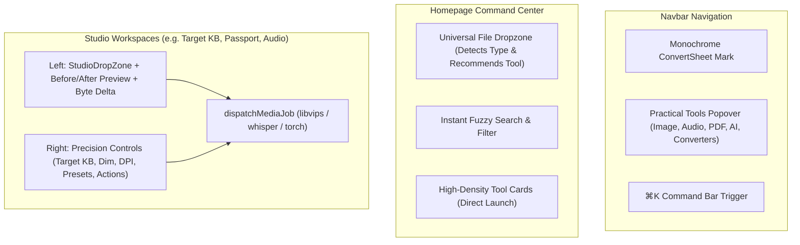

# Usage-Focused UI & Professional Studio Workspace Implementation Plan

> **For agentic workers:** REQUIRED SUB-SKILL: Use superpowers:subagent-driven-development to implement this plan task-by-task. Steps use checkbox (`- [ ]`) syntax for tracking.

**Goal:** Overhaul the ConvertSheet UI into a 100% usage-focused, high-contrast studio experience with universal drag-and-drop & clipboard paste (`⌘V`), remove legacy Excel bias from the header, and turn the homepage into an immediate utility command center.

**Architecture:**
1. A shared, production-grade `StudioDropZone` component supporting native file dragging, visual hover states, OS clipboard pasting (`⌘V`), and instant file metadata inspection.
2. An updated `Navbar` removing Excel converter bias and replacing it with clean monochrome branding, a `⌘K` command palette trigger, and practical categorizations (Image Studio, Audio/Speech, PDF/Docs, AI/Text, Converters, Calculators).
3. A two-column Professional Studio Workspace for `KbImageResizerTool` (covering 12 target KB, passport, and exam photo tools) with a left visual canvas and right precision parameter controls.
4. A homepage command center with a universal quick-drop zone and high-density, direct-launch utility grids.

**Architecture Diagram:**

**Tech Stack:** Next.js 14 (App Router, static export), TypeScript, Tailwind CSS, Lucide React, Vitest, Testing Library.

---

### Task 1: Create Standardized `StudioDropZone` Component & Tests

**Files:**
- Create: `frontend/src/components/tools/StudioDropZone.tsx`
- Test: `frontend/src/components/tools/__tests__/StudioDropZone.test.tsx`

- [ ] **Step 1: Write the failing unit test for `StudioDropZone`**
Test drag-and-drop states, clipboard paste events (`⌘V`), file metadata display (filename, size, dimensions), and replace/clear actions.

- [ ] **Step 2: Run test to verify it fails**
Run: `cd frontend && npm test -- src/components/tools/__tests__/StudioDropZone.test.tsx`
Expected: FAIL with "Cannot find module '../StudioDropZone'"

- [ ] **Step 3: Implement `StudioDropZone`**
Implement the component with `useFileDropAndPaste`, file size formatting, dimension reader, clipboard paste support, and sleek monochrome styling.

- [ ] **Step 4: Run test to verify it passes**
Run: `cd frontend && npm test -- src/components/tools/__tests__/StudioDropZone.test.tsx`
Expected: PASS

- [ ] **Step 5: Commit**
`git add frontend/src/components/tools/StudioDropZone.tsx frontend/src/components/tools/__tests__/StudioDropZone.test.tsx && git commit -m "feat(ui): add StudioDropZone with clipboard paste and metadata inspection"`

---

### Task 2: Redesign Header & Navbar (Remove Excel Bias, Add Practical Tools Menu)

**Files:**
- Modify: `frontend/src/components/layout/Navbar.tsx`
- Test: `frontend/src/components/layout/__tests__/layout.test.tsx`

- [ ] **Step 1: Update Navbar tests to reflect new monochrome branding & practical tool categories**
Update `layout.test.tsx` to assert modern branding and removal of legacy "Spreadsheets & Docs" Excel labels.

- [ ] **Step 2: Update `Navbar.tsx`**
- Replace Excel spreadsheet green branding with modern monochrome geometric icon.
- Replace legacy Excel converter menu with a 6-category practical tools popover:
  - Image & Photo Studio
  - Audio & Speech Tools
  - PDF & Document Engine
  - AI & Text Utilities
  - File Converters
  - Calculators
- Elevate the `⌘K` search button with clear shortcut styling.
- Strip marketing badges.

- [ ] **Step 3: Run Navbar tests**
Run: `cd frontend && npm test -- src/components/layout/__tests__/layout.test.tsx`
Expected: PASS

- [ ] **Step 4: Commit**
`git add frontend/src/components/layout/Navbar.tsx frontend/src/components/layout/__tests__/layout.test.tsx && git commit -m "feat(header): remove excel bias, modernize navbar with practical tools popover"`

---

### Task 3: Overhaul `KbImageResizerTool` into a Two-Column Professional Studio Workspace

**Files:**
- Modify: `frontend/src/components/tools/KbImageResizerTool.tsx`
- Test: `frontend/src/components/tools/__tests__/TargetKbAndImageSuite.test.tsx`

- [ ] **Step 1: Verify current tests pass**
Run: `cd frontend && npm test -- src/components/tools/__tests__/TargetKbAndImageSuite.test.tsx`

- [ ] **Step 2: Upgrade `KbImageResizerTool` to use `StudioDropZone` in a two-column workspace**
- Left Column: `StudioDropZone` with clipboard paste (`⌘V`), image preview, and before/after byte metrics (`Original KB → Target KB, Delta %`).
- Right Column: Precision inputs (Target KB slider + custom number input, quick pills, dimensions $W \times H$, DPI 300, aspect lock, format, government presets).
- High-contrast execution button and direct download action.

- [ ] **Step 3: Run image tool tests**
Run: `cd frontend && npm test -- src/components/tools/__tests__/TargetKbAndImageSuite.test.tsx`
Expected: PASS

- [ ] **Step 4: Commit**
`git add frontend/src/components/tools/KbImageResizerTool.tsx && git commit -m "feat(image-tools): upgrade target KB tool to two-column studio workspace with clipboard paste"`

---

### Task 4: Redesign Homepage Command Center & Universal Quick-Drop

**Files:**
- Modify: `frontend/src/components/home/HomeCommandHero.tsx`
- Modify: `frontend/src/app/page.tsx`
- Test: `frontend/src/components/home/__tests__/HomeCommandHero.test.tsx`

- [ ] **Step 1: Update HomeCommandHero tests**
Ensure tests check for the new universal command center and quick filter pills.

- [ ] **Step 2: Update `HomeCommandHero.tsx` and `app/page.tsx`**
- Remove default `DynamicConverterCard` Excel embed from the hero.
- Replace with:
  1. Universal Quick-Drop zone (Drop any file to instantly inspect format and navigate to the right tool).
  2. Instant `⌘K` fuzzy search with autofocus.
  3. Category filter pills: `All`, `Images & Identity`, `Audio & Voice`, `PDF & Docs`, `AI Utilities`, `Converters`.
  4. High-density, direct-launch tool matrix.
- Remove marketing buzzwords, fluff, and generic trust claims.

- [ ] **Step 3: Run homepage tests**
Run: `cd frontend && npm test -- src/components/home/__tests__/`
Expected: PASS

- [ ] **Step 4: Commit**
`git add frontend/src/components/home/HomeCommandHero.tsx frontend/src/app/page.tsx frontend/src/components/home/__tests__/ && git commit -m "feat(homepage): replace marketing fluff with usage-focused command center and universal dropzone"`

---

### Task 5: Full Test Suite & Static Export Build Verification

- [ ] **Step 1: Run the full test suite**
Run: `cd frontend && npm test`
Verify all 97+ test suites pass (100% green).

- [ ] **Step 2: Run production static export build**
Run: `cd frontend && npm run build`
Verify all 2,062+ static pages build cleanly with zero errors.

- [ ] **Step 3: Commit and Push**
`git push origin main`
